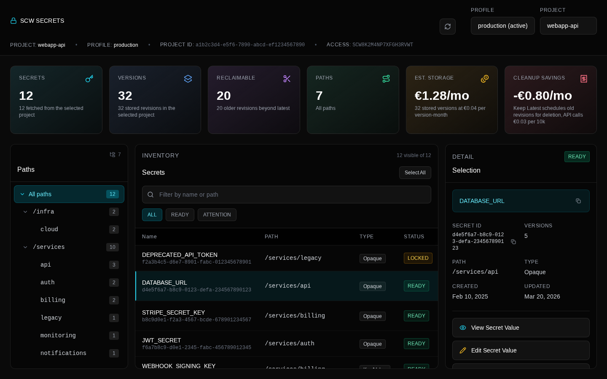

# Scaleway Secrets Desktop

Desktop app for browsing and managing [Scaleway Secret Manager](https://www.scaleway.com/en/secret-manager/) secrets.

Built with [Tauri 2](https://v2.tauri.app/), Rust, React, TypeScript, and Tailwind CSS.

## Disclaimer

This project is provided as-is, with no guarantee or warranty of any kind. Use it at your own risk.



## Features

- **Profile & project switching** — reads `~/.config/scw/config.yaml` and environment variables
- **Account details** — Settings shows the selected profile's organization, default project, the key's expiry and the organization's max API key lifetime (when the key may read them)
- **Path navigator** — browse secrets organized by path hierarchy
- **Secrets inventory** — searchable table with status and version badges, filter by status
- **Spotlight search** — `Ctrl/Cmd+P` to search across all secrets, with `id:`, `name:`, `path:`, `tag:`, `type:` field prefixes
- **Deep search** — opt-in mode that prefetches secret values for the current project so spotlight matches payload contents (`value:` prefix); cached in memory only, clearable from Settings
- **Cleanup plan** — click the Reclaimable card to review prunable revisions per secret with accurate active-version counts (excludes already-scheduled deletions)
- **Multi-select** — shift+click for range, ctrl+click to toggle, batch operations
- **View secret values** — single or batch, displayed in a full-screen overlay with copy support
- **Create secret** — create new secrets with name, path, type, value, and tags
- **Edit secret values** — modify a value and save as a new version
- **Copy as KEY=VALUE** — batch-copy selected secrets for `.env` files
- **Version history** — modal with all versions, enable/disable/destroy actions
- **Keep Latest** — prune old versions, keeping only the latest revision (single or batch)
- **Column sorting** — sort inventory by name, version count, or updated date
- **Secret types** — displayed in inventory table and detail panel
- **Cost estimates** — storage cost and potential cleanup savings in stats cards
- **Tags** — displayed in the inventory table
- **Select all** — quick button to select all visible secrets
- **Manage secret** — opens the Scaleway console for the selected secret
- **Schedule deletion** — single or batch delete with confirmation

## Install

### Quickstart

```bash
curl -fsSL https://raw.githubusercontent.com/Andarius/scw-secrets-desktop/master/bin/quickstart.sh | bash
```

Installs the latest packaged app for the platform: the AppImage on Linux x64 (no sudo, a menu entry, and in-app
updates; `SCW_SECRETS_APP=snap` installs the snap instead), zipped `.app` on macOS
(quarantine cleared automatically). `SCW_SECRETS_VERSION=v0.6.0` pins a release,
`SCW_SECRETS_APP=source` clones and builds from the checkout instead
(`SCW_SECRETS_DIR` overrides the default `~/scw-secrets-desktop`).

Release assets are signed with [minisign](https://jedisct1.github.io/minisign/) (key in `src-tauri/update-signing.pub`).
The quickstart, `just snap-install-release` and in-app updates refuse an asset that fails the check, so the
quickstart needs `minisign` installed (`apt install minisign`, `brew install minisign`). To check a manual download:

```bash
minisign -Vm ScwSecrets.AppImage -P RWTGhZ8NSmkVq/y4pDwht/KbYbX8RV6RA0djY4b7nLvDadE2PAsmhLJo
```

## Setup

```bash
bun install
```

Requires [Rust](https://rustup.rs) (version pinned in `rust-toolchain.toml`), [Bun](https://bun.sh) 1.3+ and the
[Tauri system prerequisites](https://v2.tauri.app/start/prerequisites/) for your platform.

### macOS

If macOS shows "app is damaged and can't be opened", clear the quarantine attribute:

```bash
xattr -dr com.apple.quarantine "/Applications/ScwSecrets.app"
```

## Development

```bash
bun run dev          # Tauri desktop window + Vite HMR (port 5181)
bun run mock         # Browser preview with mock data (port 5199)
```

Native commands run in the Rust process. Production frontend assets are embedded by Tauri at build time;
rebuild the desktop app to update them.
Opening the frontend in a browser automatically shows a labeled preview with sample data.

When upgrading from the previous desktop runtime, Scaleway profiles and saved window geometry are reused.
Window geometry is saved shortly after resizing or moving, as well as on exit.
UI preferences start fresh because Tauri uses a different WebView storage origin.

## Testing

```bash
bun run test         # Frontend unit tests (bun test)
just rust-check      # Rust formatting, lint and unit tests
bun run test:e2e     # E2E tests (Playwright against mock mode)
```

## Build

```bash
bun run build        # Vite production build → dist/
bun run bundle       # Native installers → src-tauri/target/release/bundle/
just bundle-deb      # Linux .deb
just bundle-mac      # macOS .app and .dmg
just bundle-msi      # Windows .msi
bun run typecheck    # TypeScript check (frontend)
just rust-check      # Rust formatting, lint and unit tests
```

## Linux Release

Download the Linux release from the GitHub releases page: the `.AppImage` or the `.snap`.
The snap uses the system WebKitGTK 4.1 (`sudo apt install libwebkit2gtk-4.1-0` on Debian/Ubuntu).
The AppImage is self-contained (run this way it gets no menu entry; the quickstart adds one):

```bash
chmod +x ScwSecrets.AppImage
./ScwSecrets.AppImage
```

The app needs a graphical session (WebKitGTK 4.1). If you launch it from a plain shell without
a usable display, GTK will fail with `cannot open display`.

## Project Structure

```
src/
├── mainview/
│   ├── main.tsx              # React entry point (loads App, or MockApp with VITE_MOCK=1)
│   ├── App.tsx               # React application shell
│   ├── assets/               # Global styles (index.css)
│   ├── lib/
│   │   ├── rpc.ts            # Typed Tauri command client
│   │   ├── secret-list.ts    # Filtering, sorting, and selection reconciliation
│   │   ├── secret-versions.ts # Version pruning plan and next revision logic
│   │   ├── inventory-selection.ts # Row click and select-all state helpers
│   │   ├── value-format.ts   # Secret value parsing, conversion, and structure editing
│   │   ├── settings.ts       # Persisted app settings
│   │   ├── api-key.ts        # API key expiry and lifetime labels
│   │   └── clipboard.ts, console.ts
│   ├── hooks/                # React hooks, one per file (useSaveSecretValue, useNextRevision…)
│   ├── mock/                 # Mock mode: MockApp (sample data) and the inert mock API
│   └── components/
│       ├── layout/           # Header, PaneRail, StatsCards, UpdateBanner
│       ├── panels/           # Navigator (path tree), Inventory (secrets table), DetailPanel
│       ├── modals/           # ValueModal (view/edit a value), CreateSecret, History, Cleanup, Settings, Logs
│       ├── secret-value/     # ValueViewer, ValueStructureEditor
│       ├── inputs/           # HeaderSelect, HighlightedTextarea, KeyFilterInput
│       └── search/           # SpotlightSearch
└── shared/
    ├── models.ts             # Shared types
    └── rpc.ts                # Typed native command contract
```

`src-tauri/` contains the Rust backend, native command handlers, Tauri configuration and capabilities.
